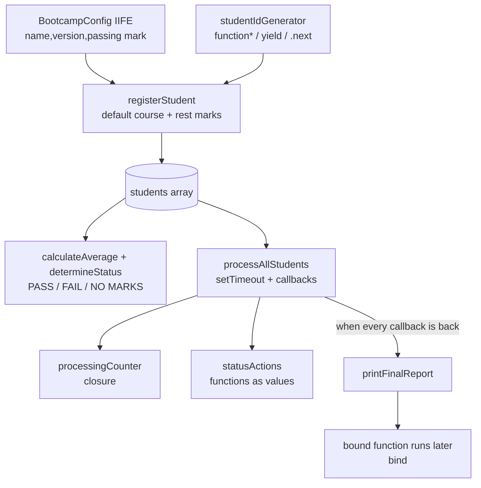

# Student Bootcamp Manager

> **GoldenByte Coding Bootcamp** | JavaScript Essentials 2,Module 4 (3-day project sprint)

## Project Description

The Student Bootcamp Manager is a JavaScript application that a coding bootcamp could use to manage its students from registration to final results.It registers students with their course and marks,gives every student a unique ID,works out each student's average and whether they PASS or FAIL,processes every student asynchronously (simulating a real delay),and finishes with a clear final report for the whole class.

The main goal of the project is to show the advanced function concepts from Module 4 working together in one real application: default,rest and spread parameters,closures,an IIFE,functions as values,higher-order functions,callbacks,`this` with `call()`,`apply()` and `bind()`,a generator,and asynchronous code with `setTimeout()`.

## Features

- **Student registration** with name,course and any number of marks
- **Default course** (Full-Stack Web Development) when no course is given
- **Unique student IDs** (`GB-001`,`GB-002`,...) produced by a generator
- **Averages** rounded to one decimal place,and **PASS / FAIL** status
- **Configurable passing mark** (default 50),protected inside an IIFE and validated before it can change
- **Processing counter** protected inside a closure
- **Asynchronous processing** with `setTimeout()`,where a callback decides the next step for each student
- **Final report** with every student's ID,name,course,marks,average and status,plus class totals
- **Input handling**: invalid marks are ignored with a warning,invalid names are rejected,missing students and invalid processing data are handled without crashing
- **Built-in tests** for normal and edge cases
- **Bonus features**: student search,class average,highest and lowest marks,top-performing student,a "NO MARKS" status for students who haven't submitted work,and a browser view in the GoldenByte colours (gold,black,ivory and white)

## Technologies

- JavaScript (ES6+)
- Node.js (to run it in the terminal)
- Console output
- HTML and CSS (optional browser view in `index.html`)

## How to Run

You need [Node.js](https://nodejs.org) installed.No packages to install.

**Option 1: terminal (recommended)**

```bash
git clone https://github.com/Sijabulile-Ncube/student-bootcamp-manager.git
cd student-bootcamp-manager
node app.js
```

**Option 2: browser**

Open `index.html` in any browser (or use the Live Server extension in VS Code).The output appears on the page and in the browser console (F12).Click **Run again** to rerun it.

## Project Structure

```
student-bootcamp-manager/
├── app.js        the whole application (data,functions,tests,async processing,report)
├── index.html    optional browser view that shows the console output on the page
└── README.md
```

## How the Application Works (Plan)



**How students are stored:** each student is an object in the `students` array with `id`,`name`,`course` and `marks`.Every student object is created with `Object.create(studentMethods)`,so they all share three methods (`getAverage()`,`getStatus()` and `describe()`) without copying them into every object.

**How averages are calculated:** `calculateAverage(marks)` uses `reduce()` to add up the marks,divides by how many there are,and rounds to one decimal place.If there are no marks it returns `null` instead of `NaN`,and the status becomes `NO MARKS`.

## Module 4 Concepts Implemented

| Concept | Where in `app.js` | What it does in the app |
|---|---|---|
| **Default parameters** | `registerStudent(name,course = DEFAULT_COURSE,...marks)`,`determineStatus(average,passingMark = ...)`,`studentIdGenerator(prefix = "GB",startAt = 1)`,`processStudent(...,delayMs = 300)` | Owethu and Thami get the Full-Stack course automatically,and the passing mark comes from the config unless another is given |
| **Rest parameters** | `registerStudent(name,course,...marks)` and `addMarks(studentId,...newMarks)` | One function accepts 1 mark (Lesedi),5 marks (Mhlengi) or none (Thami) |
| **Spread syntax** | `student.marks = [...validMarks]`,`addMarks("GB-002",...lateAssignmentMarks)`,`push(...newMarks)`,`Math.max(...allMarks)` | Copies arrays safely and unpacks arrays into separate arguments |
| **Closure** | `createProcessingCounter()` | `processedCount` is private.Only `increment()` and `getCount()` can reach it |
| **IIFE** | `BootcampConfig` | Runs once and hides the bootcamp name,version and passing mark.`BootcampConfig.passingMark` is `undefined` from outside |
| **Functions as values** | `statusActions` object,`passFilter`,`congratulateLater` | Functions are stored in an object and in variables,then passed to other functions |
| **Higher-order functions** | `applyToStudents(studentList,action)`,`createStatusFilter(status)` | One takes a function as an argument,the other returns a new function |
| **Callbacks** | `processStudent(student,onComplete)`,`processAllStudents(list,onEachDone,onAllDone)` | When a student is processed,the callback decides the next step.When all are done,a second callback prints the report |
| **this** | `studentMethods.describe()`,`getAverage()`,`getStatus()` | `this` is the student to the left of the dot,for example `sijabulile.describe()` |
| **call()** | `formatStudentLine.call(student,"Started processing",">>")`,`printCertificateLine.call(topStudent)` | Runs a function immediately with `this` set to a chosen student |
| **apply()** | `formatStudentLine.apply(mhlengi,[...])`,`Math.max.apply(null,mhlengi.marks)` | Like `call()`,but the arguments go in as an array |
| **bind()** | `congratulateLater = formatStudentLine.bind(mhlengi,...)` | Creates a new function with `this` locked to Mhlengi,which runs later after async processing |
| **Generator,yield,.next()** | `function* studentIdGenerator()` and `idGenerator.next().value` | Pauses at each `yield` and resumes on the next `.next()`,giving unique IDs in order |
| **Asynchronous programming / setTimeout()** | `processStudent()` and `processAllStudents()` | Each student finishes after a delay,while the rest of the code keeps running |

## Explaining the Key Concepts (Code Defence Notes)

**Why a closure for the counter?**
The count needs to survive between calls but must not be changeable from outside.`createProcessingCounter()` finishes running,but the returned `increment()` and `getCount()` still remember `processedCount`.Nothing else in the app can reset or fake it.

**Why an IIFE for the configuration?**
The settings are created once when the file loads,and the passing mark should only change through `setPassingMark()`,which rejects anything that isn't a number from 0 to 100.The IIFE gives a private space for those variables and runs immediately,so the config is ready before anything else uses it.

**How do the callbacks work?**
`processStudent()` doesn't decide what happens after a student is processed.It hands the result to the callback,and the callback picks the next step from `statusActions`: certificate,support session or reminder.If the callback were removed,the students would still be processed but nothing would happen afterwards,and the final report would never print,because it waits for every callback to come back.

**What does `this` refer to?**
Inside `describe()`,`this` is whichever student the method is called on.For a standalone function like `formatStudentLine`,`this` depends on how it's called,so I set it on purpose with `call()`,`apply()` or `bind()`.

**call() vs apply() vs bind()**
- `call(thisValue,arg1,arg2)` runs the function **now**,with arguments listed one by one.
- `apply(thisValue,[arg1,arg2])` runs it **now**,with arguments in an **array**.It's useful when the data is already an array,like `Math.max.apply(null,marks)`.
- `bind(thisValue,arg1,arg2)` does **not** run it.It returns a **new function** with `this` locked in,to run later.I create `congratulateLater` on Day 2 and only call it after the async processing finishes.

**How does the generator work?**
`studentIdGenerator` is a `function*`.Each `.next()` runs it until the next `yield`,which hands back an ID like `GB-001`,then pauses with its counter remembered.The next `.next()` continues from there,so IDs can never repeat.The `while (true)` loop is safe because it pauses at every `yield`.

**Why does the `[sync]` message appear before the processed students?**
`setTimeout()` hands the waiting to the browser or Node and returns immediately,so JavaScript carries on with the next lines straight away.The `[sync]` messages are ordinary code,so they run first.The callbacks only run once the delays are over and the call stack is empty,through the event loop.

## Testing

The app runs these checks every time and prints PASS or FAIL for each:

| Type | Case | How it's handled |
|---|---|---|
| Normal | Student passes | Sijabulile (88.5%) shows PASS |
| Normal | Student fails | Mandla (35.5%) shows FAIL |
| Normal | Multiple marks | Mhlengi has 5 marks |
| Normal | Default course | Owethu gets Full-Stack Web Development |
| Edge | No marks | Thami's average is `null` and the status is `NO MARKS` (not `NaN`) |
| Edge | Only one mark | Lesedi's average is 97 |
| Edge | Invalid mark | `"abc"` and `150` are ignored for Bao,with a warning |
| Edge | Wrong data type | A name of `12345` is rejected and no ID is used up |
| Edge | Student doesn't exist | `findStudentById("GB-999")` returns `undefined`,and `addMarks` reports it |
| Edge | Invalid processing data | `processStudent(null,...)` sends an `Error` to the callback instead of crashing |
| Extra | Configurable passing mark | Changing it to 60 makes a 55 average FAIL,and changing it back makes it PASS.A passing mark of 150 is rejected |
| Extra | Unique IDs | A `Set` of all IDs is the same size as the student list |

## Sample Output (Final Report)

```
==================== FINAL STUDENT REPORT ====================
GoldenByte Coding Bootcamp | v1.0.0 | Passing mark: 50%

ID      Name              Course                      Marks               Average  Status
---------------------------------------------------------------------------------------------
GB-001  Sijabulile Ncube  Full-Stack Web Development  88,92,79,95         88.5%    PASS
GB-002  Bafana Ndlovu     Data Analytics              45,52,38,55,60      50%      PASS
GB-003  Owethu Jezile     Full-Stack Web Development  67,71               69%      PASS
GB-004  Mhlengi Ngwenya   UI/UX Design                74,81,69,90,85      79.8%    PASS
GB-005  Mandla Junior     Cloud Computing             30,41               35.5%    FAIL
GB-006  Thami Sithole     Full-Stack Web Development  none                -        NO MARKS
GB-007  Bao Kekana        Data Analytics              58,63               60.5%    PASS
GB-008  Lesedi Modikwe    UI/UX Design                97                  97%      PASS
---------------------------------------------------------------------------------------------
Total students:       8
Students processed:   8
Students who passed:  6
Students who failed:  1
No marks yet:         1

Class average:        68.6%
Highest mark:         97
Lowest mark:          30
Top student:          Lesedi Modikwe (97%)
```

## Challenges

1.**Knowing when ALL the async processing was finished.** Each student is processed with its own `setTimeout()`,and they finish at different times.My first idea was to print the report straight after starting the processing,but it printed immediately with "0 students processed",because none of the timers had finished yet.
2.**Losing `this` when a function runs later.** When I passed a function that uses `this` to run later,`this` was no longer the student,and the name came out as `undefined`.
3.**Students with no marks breaking the maths.** A student with no marks gave an average of `NaN` (0 divided by 0),which then spread into the class average and made it `NaN` too.

## Solutions

1.**Counting the callbacks.** `processAllStudents()` keeps a `finished` counter and increases it every time a student's callback comes back.Only when `finished === studentList.length` does it call `onAllDone`,which prints the report.This taught me why callbacks are needed: the code that depends on the result has to run inside (or be triggered by) the callback.
2.**Using `bind()`.** `formatStudentLine.bind(mhlengi,...)` creates a new function with `this` permanently set to Mhlengi,so it works correctly whenever it's called later.For functions that run straight away I used `call()` and `apply()`.
3.**Returning `null` for no marks.** `calculateAverage()` checks for an empty array and returns `null`,`determineStatus()` turns that into `NO MARKS`,and the class statistics only use students who actually have marks.

## Day-by-Day Progress

| Day | Focus | What was completed |
|---|---|---|
| Day 1 | Core functionality | Planned the student object and functions,registration with a default course,rest parameters for marks,spread syntax,averages and PASS/FAIL |
| Day 2 | Advanced JavaScript | IIFE config,closure counter,functions as values,higher-order functions,callbacks,`this`,`call()`,`apply()`,`bind()` and the ID generator |
| Day 3 | Async,testing and finalisation | `setTimeout()` processing with callbacks,the async order demo,the final report,normal and edge case tests,clean-up and this README |

## Possible Improvements

- Rewrite the async processing with Promises and `async/await` (the next step after callbacks)
- Save students to a file or `localStorage` so the data survives a restart
- Add a form in the browser view to register students from the page
